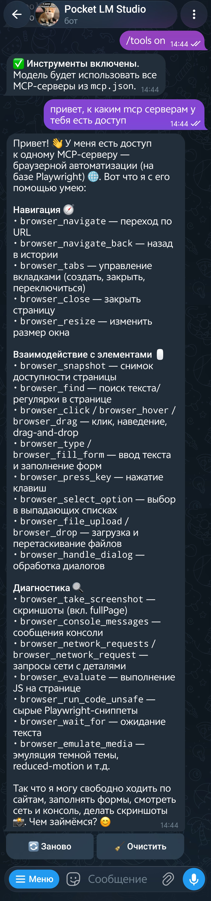

# LM Studio Telegram Bot

Телеграм-бот, который пересылает текст, фото и альбомы в локальный LM Studio,
умеет управлять моделями, хранит историю диалога
и поддерживает **MCP-инструменты**.

## Возможности

- **Текст, изображения и альбомы**
  - Поддерживаются текст, фото Telegram, изображения-документы (JPG/PNG/WebP и т.п.) и альбомы.
  - Лимиты: до **5** изображений в обычном режиме, до **10** — в расширенном при суммарном размере ≤ **20 МБ**.
  - Одно изображение — до **20 МБ**; в расширенном режиме одно изображение — до **10 МБ**.
  - Максимальная длина текстового запроса — **4000 символов** (настраивается).

- **Кнопки под ответом**
  - **«🔄 Заново»** — перегенерировать последний ответ.
  - **«🧹 Очистить»** — очистить историю с подтверждением.

- **История и контекст**
  - История диалога хранится отдельно для каждого пользователя.
  - При заполнении контекста на **80%** бот предупреждает.
  - При заполнении на **95%** история автоматически очищается, оставляя последние **4** сообщения.
  - Лимиты и поведение настраиваются через `.env`.

- **Персональные настройки генерации**
  - `/settings` — показать текущие параметры и последнее использование контекста.
  - `/temp` — температура (доступна всем).
  - `/topk`, `/topp`, `/ctxlimit`, `/maxtokens` — доступны админу.
  - `/reset_settings` — сбросить настройки к значениям по умолчанию.

- **🛠 MCP-инструменты (tools)**
  - `/tools` — показать текущий статус.
  - `/tools on` — включить использование инструментов.
  - `/tools off` — выключить использование инструментов.
  - Бот автоматически читает `mcp.json` LM Studio и передаёт в запрос **все** MCP-серверы из него.
  - Модель вызывает инструменты, LM Studio выполняет их и возвращает готовый ответ.
  - Работает как для обычного диалога, так и для перегенерации через «🔄 Заново».

  <p align="center">
    
    <br>
    <em>Модель вызывает MCP-инструмент через <code>/tools on</code></em>
  </p>

- **Управление моделями LM Studio**
  - `/models` — список моделей с inline-кнопками.
  - `/load model_key [context_length]` — загрузить модель.
  - `/unload instance_id` или `/unload all` — выгрузить модель/все модели.
  - `/reload [model_key] [context_length]` — перезагрузить модель.
  - Поддерживается нативный API LM Studio для загрузки/выгрузки/перезагрузки.
  - Embedding-модели скрываются из списка.
  - Операции с моделями блокируются глобально, чтобы не запускать их параллельно.

- **Авторизация**
  - Опциональная защита паролем через `AUTH_PASSWORD`.
  - Если пароль задан, пользователь должен отправить его боту, чтобы получить доступ.
  - `/start` доступен без авторизации.
  - При смене пароля авторизация сбрасывается.

- **Админ-режим**
  - `/sudo пароль` — войти в админ-сессию.
  - `/sudologout` — выйти из админ-сессии.
  - Постоянные админы задаются через `ADMIN_IDS`.
  - Админ-сессия имеет TTL (`ADMIN_SESSION_TTL`).
  - Только админ может менять `top_k`, `top_p`, `context_limit`, `max_tokens`.

- **Антиспам команд**
  - Между командами действует кулдаун (`COMMAND_COOLDOWN`).
  - Исключения: `/start`, `/help`, `/sudo`, `/sudologout`.

- **Логирование и файлы**
  - Команды и нажатия кнопок логируются.
  - Диалоги сохраняются в `chat_log.jsonl`.
  - Входящие фото сохраняются в `saved_photos/`.
  - Авторизованные пользователи — в `authorized_users.json`.
  - Отслеживаемые сообщения — в `tracked_messages.json`.

- **Обработка неподдерживаемых типов**
  - Стикеры, видео, видеосообщения, GIF, голосовые и аудио не поддерживаются.
  - Бот объясняет это и предлагает отправить текст или изображение.

- **Очистка**
  - `/start` и `/clean` очищают историю и удаляют отслеженные сообщения.
  - `/clean` и `/clear` сначала запрашивают подтверждение.

## Команды

| Команда | Доступ | Описание |
|---|---|---|
| `/start` | все | Сброс истории, удаление отслеживаемых сообщений, приветствие |
| `/help` | все | Список команд |
| `/stop` | все | Остановить текущую генерацию |
| `/clean`, `/clear` | все | Очистить историю с подтверждением |
| `/models` | пользователь | Список моделей LM Studio с кнопками управления |
| `/load model_key [context_length]` | пользователь | Загрузить модель |
| `/unload instance_id` / `/unload all` | пользователь | Выгрузить модель или все модели |
| `/reload [model_key] [context_length]` | пользователь | Перезагрузить модель |
| `/tools` | пользователь | Показать статус MCP-инструментов |
| `/tools on` | пользователь | Включить MCP-инструменты |
| `/tools off` | пользователь | Выключить MCP-инструменты |
| `/settings` | пользователь | Показать настройки генерации |
| `/temp значение` | пользователь | Температура (0.0–2.0) |
| `/topk значение` | 🔒 админ | top_k (1–200) |
| `/topp значение` | 🔒 админ | top_p (0.0–1.0) |
| `/ctxlimit значение` | 🔒 админ | Лимит контекста (1000–200000) |
| `/maxtokens значение` | 🔒 админ | Максимум токенов (64–32768) |
| `/reset_settings` | пользователь | Сбросить настройки к дефолтным |
| `/system` | пользователь | Показать/задать системный промпт |
| `/summary` | пользователь | Управление резюме диалога |
| `/sudo пароль` | все | Войти в админ-режим |
| `/sudologout` | все | Выйти из админ-режима |
| `/dice [N]`, `/roll` | все | Бросить N кубиков (1–6) |
| `/coin`, `/flip` | все | Орёл или решка |
| `/about` | все | О боте и аптайме |

> 🔒 Команды, отмеченные как админские, требуют `ADMIN_PASSWORD` и активной сессии `/sudo` либо ID из `ADMIN_IDS`. Если `ADMIN_PASSWORD` не задан, ограничение не действует.

## Установка

```bash
#1
git clone https://github.com/zlogalqwq/lm-studio-tg-bot.git
cd lm-studio-tg-bot
python -m venv .venv
source .venv/bin/activate    # Windows: .venv\Scripts\activate
pip install -r requirements.txt
cp .env.example .env         # заполните TELEGRAM_TOKEN и остальное
python run.py                # сервер в LM Studio должен быть запущен

#2
git clone https://github.com/zlogalqwq/lm-studio-tg-bot.git
cd lm-studio-tg-bot
"ZZZ Setup + start.bat"      # КАВЫЧКИ НЕ ЗАБЫВАТЬ (не запустится)
```

## Настройка MCP-инструментов

Чтобы бот мог использовать инструменты из LM Studio:

1. В LM Studio откройте **Developer → Server Settings** и включите:
   - **Require Authentication** — обязательно для работы MCP через API.
   - **Allow calling servers from mcp.json** — без этого плагины не будут доступны.
   - **Allow per-request MCPs** — если используете эфемерные серверы.

2. Создайте API-токен: **Server Settings → Manage Tokens → Create Token**. Права — **Full Access** (или хотя бы **Chat + MCP**).

3. Добавьте токен в `.env`:

```env
LM_STUDIO_API_TOKEN=ваш_токен_из_LM_Studio
```

> ⚠️ Не путайте с `LM_STUDIO_API_KEY` — это разные переменные. `LM_STUDIO_API_TOKEN` нужен для нативного API.

4. Путь к `mcp.json` (если файл не в стандартном месте):

```env
MCP_JSON_PATH=C:\Users\ваш_юзер\.lmstudio\mcp.json
```

По умолчанию используется `~/.lmstudio/mcp.json`.

5. Проверьте работу:
   - `/models` — должен показать список без ошибки 401.
   - `/tools on` — включит инструменты.
   - Отправьте запрос, требующий инструмента (например, «найди в интернете…»).

> 💡 В логах бота при включённых инструментах будет строка
> `MCP integrations enabled: N server(s) — mcp/server1, …`.
> Если `N = 0` — `mcp.json` не найден по указанному пути.

## Выключение

```bash
CTRL + C # На клавиатуре, либо просто закрыть терминал
```

## Переменные окружения

См. `.env.example`.

## Лицензия

MIT — см. `LICENSE`.